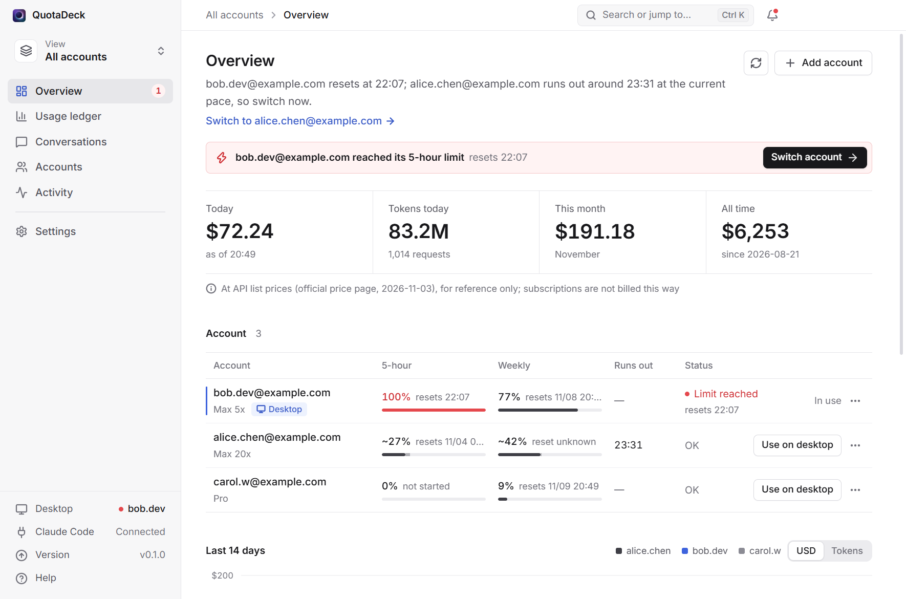
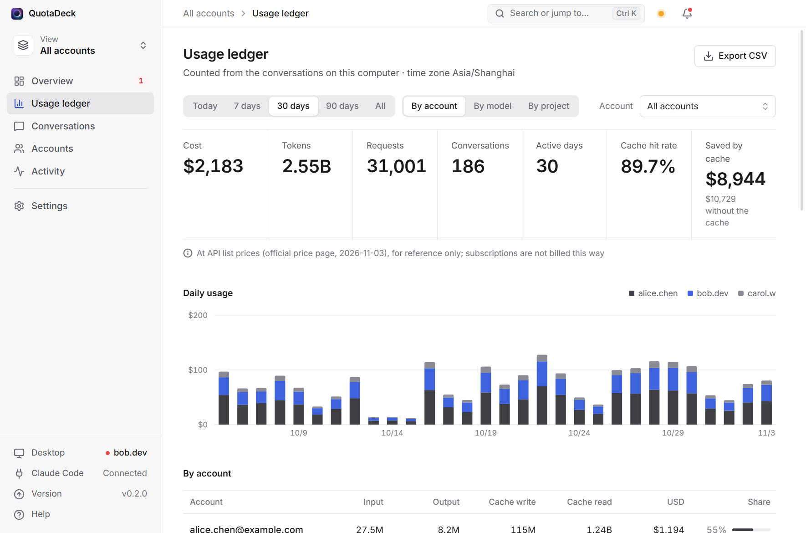
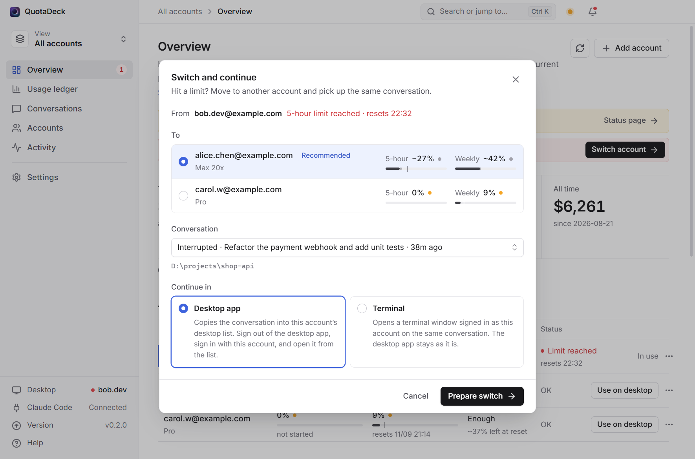
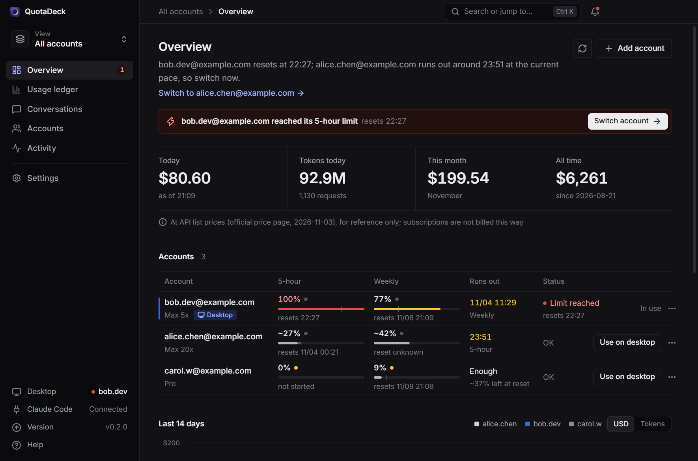

<p align="center">
  
</p>

<h1 align="center">QuotaDeck</h1>

<p align="center">
  <b>A multi-account panel for Claude Code</b>: see what each account has left, how many tokens it used and what that would cost at API prices; switch with one click when one runs out, and keep your conversations<br>
  Runs only on your computer · never touches sign-in credentials · Windows / macOS / Linux · unofficial
</p>

<p align="center">
  <a href="https://github.com/wtang2217-eng/quotadeck/releases/latest">Download</a> ·
  <a href="#compliance-please-read">Compliance</a> ·
  <a href="README.md">中文</a>
</p>

<p align="center">
  
</p>

## What it does

If you have more than one Claude account and work in the **Code tab of the Claude desktop app** or with `claude` in a terminal, you know these problems:

- you can't tell which account has quota left, when it resets, or how much each one has used;
- when one runs out you sign out and in again, and **the conversation list on the left "disappears"**;
- to continue the conversation you were in, you have to dig it up yourself.

QuotaDeck takes care of them:

| | |
|---|---|
| **Quota at a glance** | Every account's plan (Pro / Max 5x / Max 20x…), 5-hour and weekly usage, reset times, and which account the desktop app is signed in to. A one-line tip says which account to use now |
| **Usage ledger** | Tokens per account, day and model (input, output, cache writes, cache reads) and **what they would cost at Anthropic's official API prices**; today, this month and all time; by account, model or project; an activity heat map; CSV export. History is kept even after Claude Code deletes old transcripts |
| **Run-out forecast and reset alerts** | "At this pace this account runs out around 21:40"; alerts at 80% / 95%; a heads-up when an account that ran out has reset |
| **One click to keep working** | When an account runs out: continue the same conversation in a terminal with another account, or switch the desktop app — the conversation is copied to the other account's list first, QuotaDeck notices when you have signed in, tells you where the conversation is and puts the "continue" prompt on your clipboard |
| **Tray popover and shortcut** | Click the tray icon for every account's quota in a small popover; `Ctrl+Shift+Q` (`⌘⇧Q` on macOS) opens the panel from anywhere; the macOS menu bar shows the current account's percentage |
| **Conversations** | Every conversation from every account, desktop and terminal, in one list: search, filter by project or account, star, export to Markdown, continue with any account |
| **One-click setup** | The first start checks your setup: installs the Claude Code CLI with the official installer if it is missing, finds the account you are signed in with, connects Claude Code — one button |
| **Everything an app should have** | Splash screen, `Ctrl+K` search, notification center, light / dark, accent and density options, English and Chinese, click sounds (can be turned off), update check |

<p align="center">
  
</p>

<p align="center">
  
  
</p>

## Compliance (please read)

Every design decision follows [Claude Code's legal and compliance notes](https://code.claude.com/docs/en/legal-and-compliance) and the [Anthropic Usage Policy](https://www.anthropic.com/legal/aup):

- **Runs only on your computer.** No server, nothing uploaded. Its small local service listens on `127.0.0.1` only. The one network call is the update check against GitHub, which you can turn off.
- **Only your own accounts.** Lending accounts, using someone else's, account pools, relays and shared plans break Anthropic's terms. QuotaDeck offers none of that and does not support such use.
- **Never touches credentials.** QuotaDeck never reads, copies, stores or uploads your tokens or cookies. The official notes say third-party developers "may not collect, store, or intermediate Claude.ai credentials", and sign-in must go through Anthropic's own flow. Adding an account therefore opens Claude Code's official `claude auth login` page, where you sign in the way you always do (Google, email code, …); Claude Code keeps that sign-in in its own folder.
- **No API calls for quota numbers.** Only data that Claude Code and the desktop app write on your computer is read: the quota the terminal status line receives, the desktop app's local usage records, token counts in transcripts, and the event fired when a limit is hit. Your sign-in is never used to call anything.
- **Every switch is your click.** There is no unattended rotation.
- **You sign in to the desktop app yourself.** The desktop app holds one sign-in at a time and has no account switcher. Switching without signing in would mean storing your credentials, which the terms forbid, so a desktop switch needs an official sign-in (about 15 seconds). In the terminal, Claude Code keeps each account's sign-in, so switching needs none.
- **The conversation merge is unofficial.** It copies conversation list files inside the desktop app's data folder: copy only, never delete, back up first, undo any time. A major desktop update may break it. Chat and Cowork data are never touched.
- **Dollar amounts are for reference.** They show what the tokens would cost at API list prices. Subscriptions are billed by plan, not by this number.

There is a **grey area** you have to judge for yourself: the terms do not limit how many accounts one person may have, but the usage policy forbids intentionally circumventing product limits, and plan quotas assume ordinary individual use. Moving to account B when account A runs out is not explicitly forbidden; creating accounts to get more quota, or rotating them around the clock, is likely to be seen as circumvention and risks a ban. The officially supported way to keep going is [usage credits](https://code.claude.com/docs/en/costs#add-usage-credits-to-your-subscription) or a bigger plan.

## Install

Download from [Releases](https://github.com/wtang2217-eng/quotadeck/releases/latest):

| System | File | First start |
|---|---|---|
| Windows 10 / 11 | `QuotaDeck-x.y.z-setup.exe` (installer) or `QuotaDeck-x.y.z-portable.exe` | The installers are not code-signed: on "Windows protected your PC" click "More info → Run anyway" |
| macOS | `QuotaDeck-x.y.z-mac-universal.dmg` (Apple silicon and Intel) | Drag it to Applications. If macOS blocks the first start, open System Settings → Privacy & Security and click "Open Anyway" |
| Linux | `.AppImage` or `.deb` | `chmod +x` the AppImage, then run it |

The first start opens **one-click setup**: it checks the desktop app, the Claude Code CLI and your signed-in account, and fixes what is missing with one click.

## How to use

1. **Add accounts**: click "Add account", confirm it is your own, and sign in on Claude's official page in the browser. The account already signed in at the terminal can be added with one click. Claude Code renews sign-ins itself; QuotaDeck tells you if one needs signing in again.
2. **Connect Claude Code** (part of the setup): QuotaDeck adds two entries to `~/.claude/settings.json` — a hook that tells the panel when a limit is hit, and the terminal status line. Nothing else changes, a backup is made first, and the settings page undoes it with one click.
3. **When an account runs out**: click "Switch" in the notification and choose
   - **Continue in a terminal**: opens a terminal with the suggested account on the same conversation;
   - **Switch the desktop app**: the conversation is copied to the other account's list, then you sign out and in. QuotaDeck notices, puts the "continue" prompt on your clipboard, and you open the same conversation on the left and paste.
4. **Read the ledger**: "Usage ledger" on the left. The scope switcher at the top left shows a single account.

## FAQ

**Can this get my account banned?** The tool does nothing the terms forbid. The remaining risk comes from relaying between accounts itself; see the grey area above.

**Do the dollar amounts match the official prices?** Every price was checked against [Anthropic's price page](https://platform.claude.com/docs/en/about-claude/pricing) (cache writes and reads, fast mode, Haiku's long-prompt tier, web search and US-only inference follow the official rules), and the panel shows the date of the price list. Claude Code also records its own cost in the transcript; on real data, 52 of the 57 complete conversations match it to the cent. The rest differ because Claude Code still prices Sonnet 5.5 cache reads at the old $0.20 (the official price is $0.10, which the ledger uses), or because a resumed conversation only records its last run. Requests Claude Code makes in the background (compacting context, titles, web search) are not in the transcript; the ledger adds them from Claude Code's own totals and shows them as "Background requests".

**What is "Old account" in the ledger?** An account that was used on this computer but is not in the panel. Its usage gets its own row so the totals add up; you can rename it, for example to its email.

**Where is my data?** QuotaDeck's own data is in `~/.quotadeck/`: accounts, settings, the ledger and backups — no credentials. Each extra account's Claude Code configuration is in `~/.quotadeck/profiles/<id>/`; that folder contains the sign-in Claude Code saved, so treat it like a password.

**How are conversations shared between accounts?** Terminal: each account has its own configuration folder (Claude Code's `CLAUDE_CONFIG_DIR`), and QuotaDeck links transcripts, settings, CLAUDE.md, skills and so on to the main folder, so every account sees the same ones. Desktop: see the conversation merge above.

**How do I uninstall?** Click "Disconnect Claude Code" in the settings (removes the hook and status line), then uninstall; delete `~/.quotadeck/` to remove everything.

## Build from source

```bash
npm install
npm run dev          # development
npm run dev:demo     # demo data, your real accounts are not read
npm test             # unit tests
npm run smoke        # the core logic against your real data (read-only)
npm run dist         # Windows installers (dist:mac / dist:linux for the others)
```

`src/main/core` holds the Electron-free logic (accounts, quota, ledger, merge, hooks, terminal launch), `src/main` the tray, notifications and windows, `src/renderer` the UI, and `src/shared` the shared types. Every push to a `ci/**` branch builds the installers on Windows, macOS and Linux and starts the packaged app to take screenshots.

## Credits

- UI sounds are rendered from the [earshot](https://github.com/Leonxlnx/earshot) (MIT) library; see `scripts/sounds.json`.
- [Inter](https://rsms.me/inter/) (OFL) and [Lucide](https://lucide.dev) icons (ISC).
- Inspired by [claude-swap](https://github.com/realiti4/claude-swap) (MIT), with a different approach: it stores and swaps credentials, QuotaDeck never touches them.

## Disclaimer

QuotaDeck is an unofficial community tool, not affiliated with or endorsed by Anthropic. Claude and Claude Code are trademarks of Anthropic. You use it at your own risk.

[MIT License](LICENSE)
