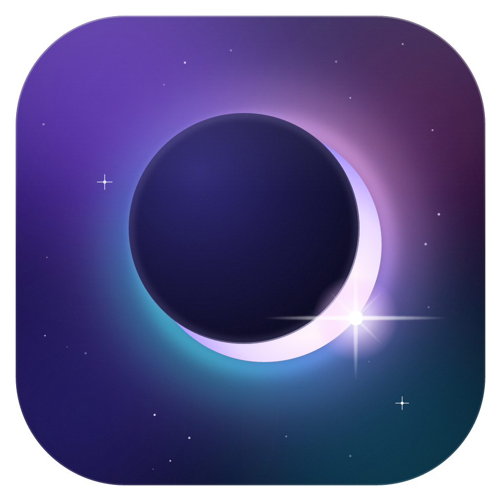
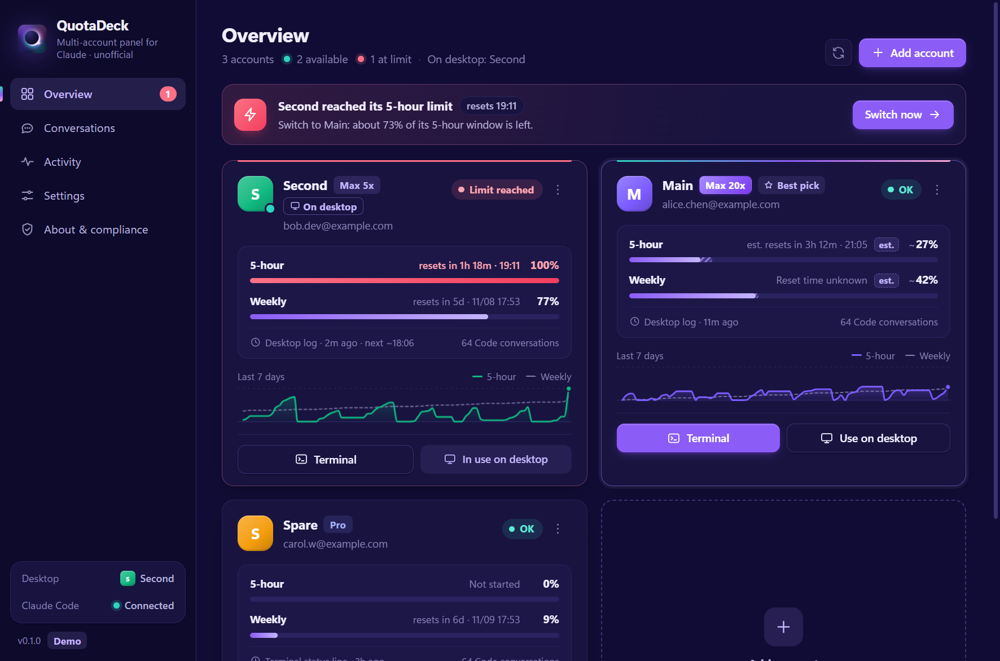
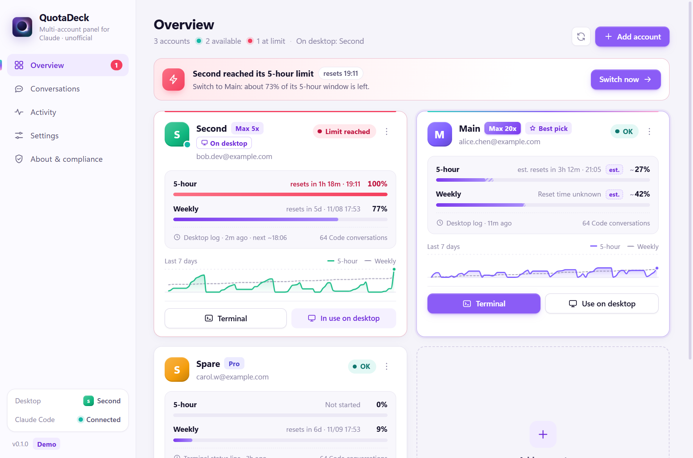

<p align="center">
  
</p>

<h1 align="center">QuotaDeck</h1>

<p align="center">
  <b>A multi-account panel for Claude Code</b>: see every account's plan and usage at a glance, switch with one click when one runs out, and keep your conversations<br>
  Runs only on your computer · never touches your login credentials · unofficial
</p>

<p align="center">
  <a href="https://github.com/wtang2217-eng/quotadeck/releases/latest">Download</a> ·
  <a href="#compliance-please-read">Compliance</a> ·
  <a href="README.md">中文</a>
</p>

<p align="center">
  
</p>

## What it does

If you have more than one Claude account (say a Max and a Pro) and work in the **Claude desktop app's Code tab** or with `claude` in a terminal, you know these problems:

- You can't tell how much each account has left, or when it resets.
- When one runs out you sign out and back in, **and the desktop conversation list "disappears"**.
- To keep going with the conversation you were in, you dig through history by hand.

QuotaDeck fixes exactly that:

| | |
|---|---|
| **Usage overview** | Plan (Pro / Max 5x / Max 20x…), 5-hour and weekly usage, reset times and a 7-day chart for every account |
| **Alerts** | Notices at 80% / 95%, and a desktop notification the moment an account hits its limit, with the best account to switch to (remaining usage × plan size) |
| **Continue in one click** | One click opens a terminal as another account **and resumes the conversation you were in**, optionally sending "continue" for you |
| **Desktop switching without losing conversations** | Merges the Code tab conversation lists of your accounts, so after you sign in with another account the same projects and conversations are there |
| **Every conversation in one place** | All accounts, desktop and terminal, searchable, resumable with any account |
| **Terminal status line** | Shows the account and its live usage at the bottom of terminal Claude Code, and which account to switch to when it runs low |
| **Tray** | The crescent in the tray icon shows the current account's state (green ok, amber low, red limit reached) |
| **Click sounds** | Subtle sounds for buttons, toggles and alerts; switch them off or set the volume in Settings |

Windows is fully supported (desktop app and terminal). On macOS and Linux the terminal features work too, and the desktop app's data folder is detected automatically.

<p align="center">
  
</p>

## Compliance (please read)

Every design decision follows Claude Code's [Legal and compliance](https://code.claude.com/docs/en/legal-and-compliance) page and Anthropic's [Usage Policy](https://www.anthropic.com/legal/aup):

- **It runs only on your computer.** No server, nothing is uploaded. Its small built-in server listens on `127.0.0.1` only.
- **Only your own accounts.** Lending accounts, using someone else's, account pools, relays and carpooling violate Anthropic's terms. QuotaDeck has no such features and does not support such use.
- **It never touches login credentials.** QuotaDeck never reads, copies, stores or uploads tokens or cookies. The terms say developers "may not collect, store, or intermediate Claude.ai credentials or session tokens — sign-in to a Claude account must complete through Anthropic's own flow". Adding an account therefore opens Claude Code's own `claude auth login` page, and Claude Code keeps the sign-in in its own folder.
- **Usage numbers without API calls.** Only data Claude Code and the desktop app write on your computer is read: the status line's usage data, the desktop app's local usage history, and the limit events. Your login is never used to call any API.
- **Every switch needs your click.** There is no unattended rotation.
- **Desktop sign-in is yours to do.** The desktop app holds one account at a time; switching means signing out and in (about 15 seconds). Switching without signing in would require storing your credentials, which the terms forbid.
- **Conversation merging is unofficial.** It copies conversation list files inside the desktop app's data folder: copy only, nothing deleted, backed up first, undoable. A major desktop update may break it. Chat and Cowork histories are not touched.

One **grey area** is yours to judge: the terms set no limit on how many accounts a person has, and the docs show how to stay signed in to several. But the usage policy forbids intentionally bypassing product restrictions, and plan limits assume ordinary individual use. Switching from account A to B when A runs out is not explicitly forbidden, but registering accounts just for more usage, or rotating 24/7, may well be treated as bypassing limits and risks a ban. The officially supported way to keep going is [usage credits](https://code.claude.com/docs/en/costs#add-usage-credits-to-your-subscription) or a higher plan.

## Install

1. Install [Claude Code](https://code.claude.com/docs/en/setup) so that `claude` runs in a terminal.
2. Download from [Releases](https://github.com/wtang2217-eng/quotadeck/releases/latest): `QuotaDeck-x.y.z-setup.exe` or `-portable.exe` on Windows, `.dmg` on macOS, `.AppImage` / `.deb` on Linux.
3. The builds are not code-signed: on Windows choose "More info → Run anyway"; on macOS right-click → Open the first time.

## Usage

1. **Add accounts**: click "Add account", confirm it is your own, and sign in on Claude's official page in the browser (Google, email code or any method the account uses). The account already signed in at the terminal can be added with one click. Claude Code renews the sign-in itself; QuotaDeck tells you if one needs signing in again.
2. **Connect to Claude Code** (recommended): QuotaDeck adds two entries to `~/.claude/settings.json` — a hook that tells it when a session hits a limit, and the status line. Nothing else is changed, a backup is made first, and Settings can remove both.
3. **When an account runs out**: click the notification, then either **continue in a terminal** with the recommended account (the conversation is resumed), or **switch the desktop app**: QuotaDeck copies your conversations into the target account's list and walks you through signing in; then open the same conversation in the sidebar and carry on.

## FAQ

**Can this get me banned?** The tool itself does nothing the terms explicitly forbid. The remaining risk comes from relaying work across accounts itself; see the grey area above.

**Where is my data?** QuotaDeck's own data is in `~/.quotadeck/` (account list, settings, backups; no credentials). Each extra account's Claude Code configuration is in `~/.quotadeck/profiles/<id>/`; that folder contains Claude Code's own sign-in, so treat it like a password.

**How is history shared?** Terminal: each account has its own configuration folder (Claude Code's documented `CLAUDE_CONFIG_DIR` method), and QuotaDeck links history, settings, CLAUDE.md, skills and more back to the main folder. Desktop: see conversation merging above.

**Uninstall?** Click "Disconnect from Claude Code" in Settings first, then uninstall. Delete `~/.quotadeck/` for a clean slate.

## Build from source

```bash
npm install
npm run dev          # development
npm run dev:demo     # demo data, never reads your real accounts
npm test             # unit tests
npm run smoke        # run the core against your real data (read-only)
npm run dist         # Windows installer
```

## Credits

- UI sounds are rendered from the [earshot](https://github.com/Leonxlnx/earshot) sound bank (MIT); see `scripts/sounds.json`.
- Inspired by [claude-swap](https://github.com/realiti4/claude-swap) (MIT), with a different approach: it stores and swaps credentials, QuotaDeck never touches them.

## Disclaimer

QuotaDeck is an unofficial community tool, not affiliated with or endorsed by Anthropic. Claude and Claude Code are trademarks of Anthropic. Use at your own risk.

[MIT License](LICENSE)
