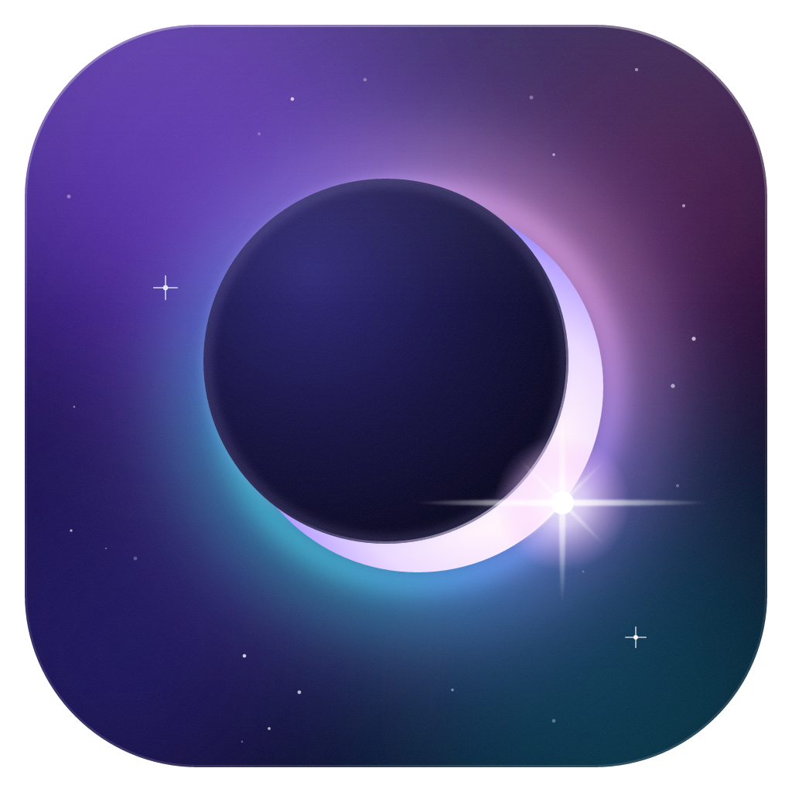
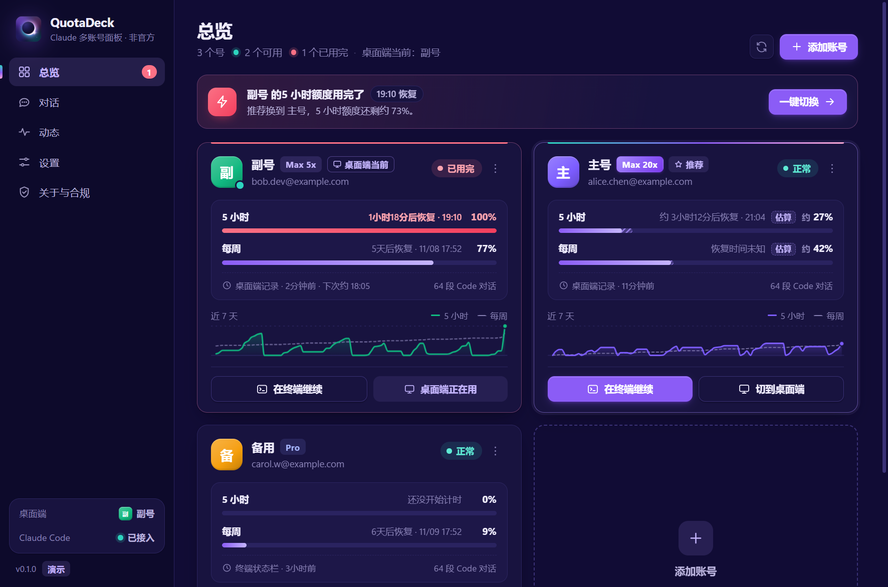

<p align="center">
  
</p>

<h1 align="center">QuotaDeck</h1>

<p align="center">
  <b>Claude Code 多账号面板</b>：每个号的套餐和额度一眼看清，用完一键换号，换号后对话不丢<br>
  只在你自己的电脑上运行 · 不碰登录凭证 · 非官方工具
</p>

<p align="center">
  <a href="https://github.com/wtang2217-eng/quotadeck/releases/latest">下载</a> ·
  <a href="#合规说明一定要看">合规说明</a> ·
  <a href="README.en.md">English</a>
</p>

<p align="center">
  
</p>

## 能做什么

如果你有不止一个 Claude 账号（比如一个 Max、一个 Pro），平时用 **Claude 桌面端的 Code 模式**或终端里的 `claude`，会遇到这些麻烦：

- 不知道哪个号还剩多少额度，几点恢复；
- 一个号用完了，换号要退出再登录，**换完之后左边的对话列表就"消失"了**；
- 想接着刚才那段对话干活，得自己去翻记录。

QuotaDeck 解决的就是这几件事：

| | |
|---|---|
| **额度总览** | 每个号的套餐（Pro / Max 5x / Max 20x…）、5 小时额度、每周额度、几点恢复、最近 7 天的用量曲线 |
| **用完提醒** | 额度到 80% / 95% 提醒；用完的那一刻弹 Windows 通知，并告诉你换哪个号最合适（按剩余额度 × 套餐大小算） |
| **一键接着干** | 点一下，用另一个号打开终端，**自动接上刚才那段对话**；也可以勾选"切过去自动发'继续'" |
| **桌面端换号不丢对话** | 把你几个号在桌面端 Code 模式里的对话列表合并起来，换号登录后，同样的项目和对话都在，点开就能接着聊 |
| **全部对话一处找** | 所有账号、桌面端和终端的对话放在一起，能搜索，能用任意一个号接着聊 |
| **终端状态栏** | 在终端的 Claude Code 底部显示当前账号和实时额度，快用完时提示该换哪个号 |
| **托盘常驻** | 右下角托盘图标的月牙颜色就是当前账号状态（绿＝正常，黄＝快用完，红＝已用完） |
| **点击音效** | 按钮、开关、提醒都有轻微音效，可在设置里关掉或调音量 |

支持 Windows（桌面端和终端），macOS / Linux 的终端功能也能用（桌面端数据位置会自动识别）。

<p align="center">
  
  
</p>

## 合规说明（一定要看）

QuotaDeck 的每个设计都是照着 [Claude Code 法律与合规说明](https://code.claude.com/docs/en/legal-and-compliance)和 [Anthropic 使用政策](https://www.anthropic.com/legal/aup)来的：

- **只在你自己的电脑上运行。** 没有服务器，不联网上传任何东西。它自带的小服务只监听 `127.0.0.1`，外面访问不到。
- **只管理你本人的账号。** 把号借给别人、用别人的号、号池、中转、拼车，都违反 Anthropic 条款。本工具不提供这些功能，也不支持这么用。
- **不碰登录凭证。** QuotaDeck 从不读取、复制、保存、上传你的 token 或 cookie。条款原文要求第三方"不得收集、保存或转手 Claude 登录凭证，登录必须走 Anthropic 自己的流程"。所以添加账号时，打开的是 Claude Code 官方的 `claude auth login` 授权页，用这个号平时的登录方式登录即可（谷歌、邮箱验证码都行）；登录信息由 Claude Code 自己保存在它自己的文件夹里。
- **额度数字不调接口。** 只读 Claude Code 和桌面端自己写在你电脑上的数据：终端状态栏收到的额度、桌面端本地的用量记录、额度用完时的中断事件。从不拿你的登录去请求任何接口。
- **每次切换都要你点一下。** 没有无人值守的自动轮换。
- **桌面端只能你自己登录。** 官方桌面端一次只登一个号，换号要退出再登录（十几秒）。想免登录切换，就只能替你保存登录凭证，而这正是条款禁止的，所以我们不做。
- **"对话合并"是非官方做法。** 它在桌面端的数据文件夹里复制对话列表文件：只复制不删除，复制前先备份，随时可以一键撤销。桌面端大版本更新后可能失效。聊天模式和 Cowork 模式的记录完全不碰。

还有一个**灰色地带**，你需要自己判断：条款没有限制一个人能有几个账号，官方文档也教了怎么同时登录多个号；但使用政策禁止"故意绕过产品里的限制"，而且套餐额度是按"一个人的正常使用"设计的。所以"A 号用完换 B 号"本身没有写明禁止，但如果为了多拿额度专门注册一堆号，或者 24 小时挂机轮换，就很可能被认定为绕限制，有封号风险。官方认可的续用办法是购买[用量额度（usage credits）](https://code.claude.com/docs/en/costs#add-usage-credits-to-your-subscription)或升级套餐。

## 安装

1. 先装好 [Claude Code](https://code.claude.com/docs/en/setup)，在终端里能运行 `claude`。
2. 到 [Releases](https://github.com/wtang2217-eng/quotadeck/releases/latest) 下载：
   - Windows：`QuotaDeck-x.y.z-setup.exe`（安装版）或 `QuotaDeck-x.y.z-portable.exe`（免安装）
   - macOS：`.dmg`；Linux：`.AppImage` / `.deb`
3. 安装包没有做代码签名：Windows 弹"已保护你的电脑"时，点"更多信息 → 仍要运行"；macOS 第一次打开时右键 → 打开。

## 怎么用

1. **加账号**：打开后点"添加账号"，勾选"这是我本人的账号"，浏览器会打开 Claude 官方授权页，用这个号平时的登录方式登录（谷歌、邮箱验证码都行）。终端里已经登录的号可以一键加入。之后由 Claude Code 自己续期登录，平时不用反复登录；某个号掉线了，面板会提醒你重新授权。
2. **接入 Claude Code**（推荐）：在总览页点"接入"。QuotaDeck 会在 `~/.claude/settings.json` 里加两项：额度用完时通知面板的钩子，以及终端状态栏。只加不改，改前自动备份，设置页可以一键撤销。
3. **额度用完时**：通知里点"一键切换"，选择：
   - **在终端接着聊**：直接用推荐的号打开终端，接上刚才那段对话；
   - **在桌面端换号**：面板先把对话复制到目标号的列表里，再告诉你怎么退出、怎么登录目标号，登录后在左侧列表打开同一段对话就能接着聊。

## 常见问题

**会不会封号？** 工具本身不做任何条款明令禁止的事。剩下的风险来自"多账号接力"这件事本身，见上面的灰色地带说明。

**我的数据存在哪？** 面板自己的数据在 `~/.quotadeck/`：账号列表、设置、备份，不含任何凭证。每个额外账号的 Claude Code 配置在 `~/.quotadeck/profiles/<编号>/`，这个文件夹里有 Claude Code 自己保存的登录，请当成密码对待，不要分享。

**多个号的对话是怎么共享的？** 终端：每个号有自己的配置文件夹（Claude Code 官方的 `CLAUDE_CONFIG_DIR` 多账号做法），QuotaDeck 把对话记录、设置、CLAUDE.md、技能等链接到主文件夹，所以每个号看到的是同一份。桌面端：见上面的"对话合并"。

**怎么卸载？** 先在设置里点"断开 Claude Code"（撤掉钩子和状态栏），再卸载程序；想清干净就把 `~/.quotadeck/` 删掉。

## 从源码运行

```bash
npm install
npm run dev          # 开发模式
npm run dev:demo     # 用演示数据运行，不读你的真实账号
npm test             # 单元测试
npm run smoke        # 用你电脑上的真实数据跑一遍核心逻辑（只读）
npm run dist         # 打包 Windows 安装包
```

目录结构：`src/main/core` 是不依赖 Electron 的核心逻辑（账号、额度、合并、钩子、启动终端），`src/main` 是托盘、通知、窗口，`src/renderer` 是界面，`src/shared` 是两边共用的类型。

## 致谢

- 界面音效由 [earshot](https://github.com/Leonxlnx/earshot)（MIT）的音效库合成，换音效见 `scripts/sounds.json`。
- 思路参考了 [claude-swap](https://github.com/realiti4/claude-swap)（MIT），但做法不同：它保存并切换登录凭证，QuotaDeck 不碰凭证。

## 声明

QuotaDeck 是社区做的非官方工具，与 Anthropic 没有任何关系，也没有得到其认可。Claude 和 Claude Code 是 Anthropic 的商标。使用本工具产生的一切后果由使用者自行承担。

[MIT License](LICENSE)
