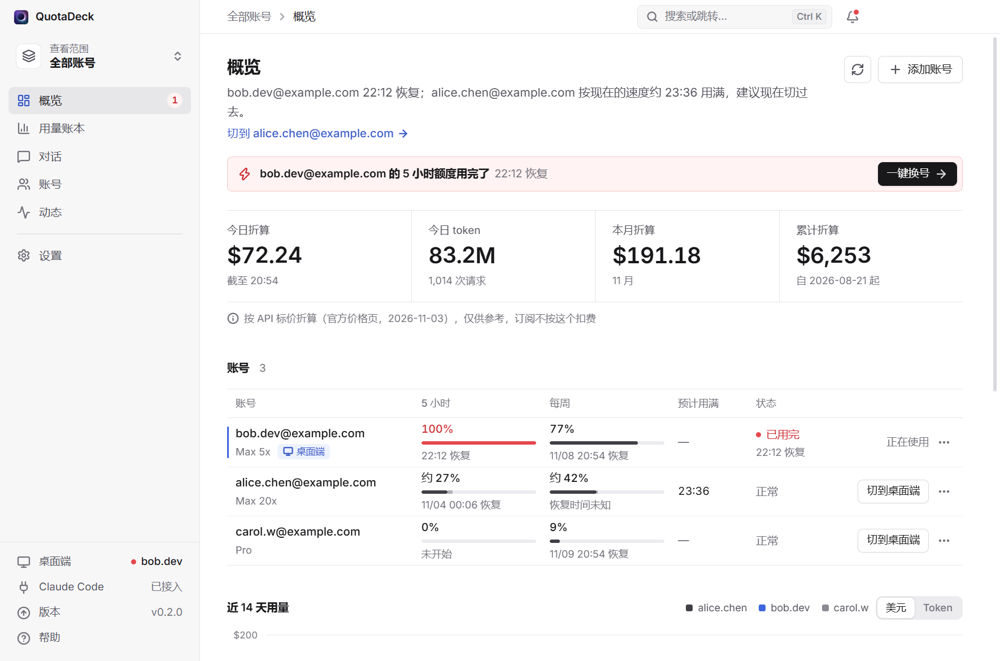
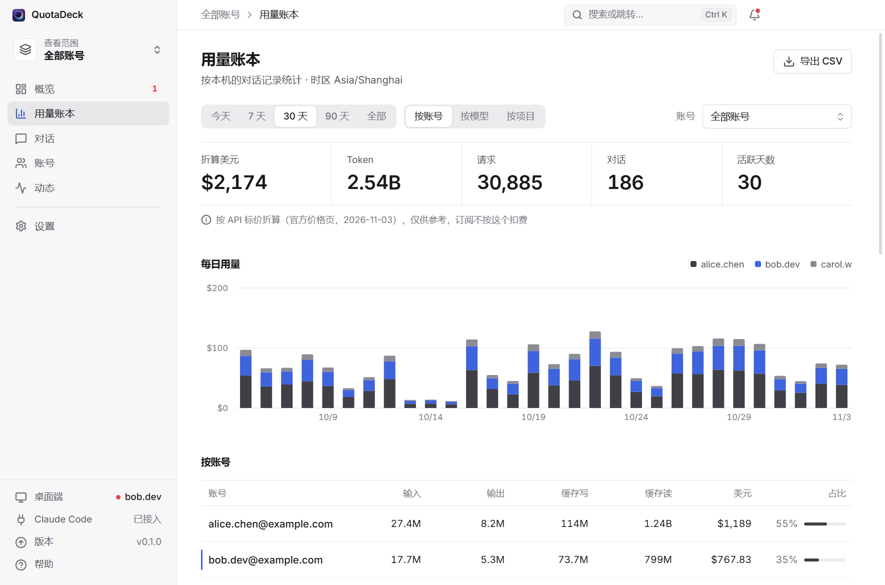
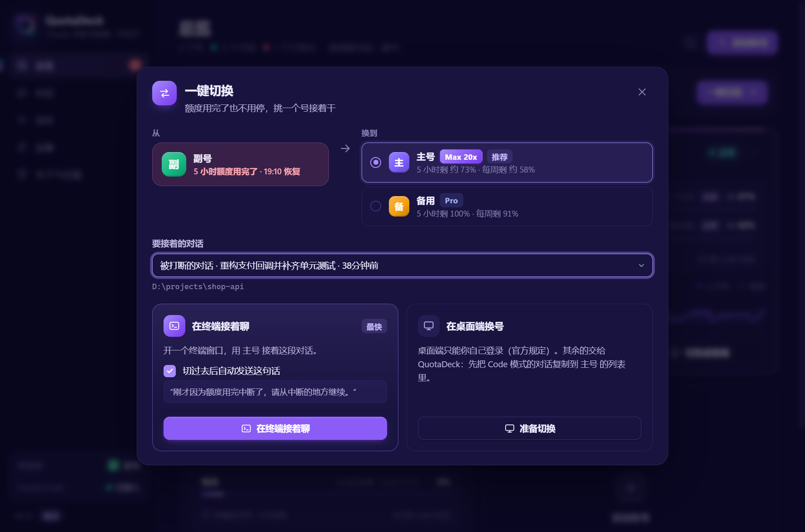
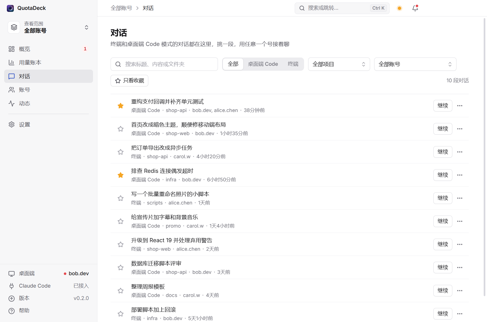

<p align="center">
  
</p>

<h1 align="center">QuotaDeck</h1>

<p align="center">
  <b>Claude Code 多账号面板</b>：每个号还剩多少额度、用了多少 token、折合多少美元，一眼看清；用完一键换号，换号后对话不丢<br>
  只在你自己的电脑上运行 · 不碰登录凭证 · Windows / macOS / Linux · 非官方工具
</p>

<p align="center">
  <a href="https://github.com/wtang2217-eng/quotadeck/releases/latest">下载</a> ·
  <a href="#合规说明一定要看">合规说明</a> ·
  <a href="README.en.md">English</a>
</p>

<p align="center">
  
</p>

## 能做什么

如果你有不止一个 Claude 账号，平时用 **Claude 桌面端的 Code 模式**或终端里的 `claude`，会遇到这些麻烦：

- 不知道哪个号还剩多少额度、几点恢复，也不知道每个号到底用了多少；
- 一个号用完了，换号要退出再登录，**换完之后左边的对话列表就"消失"了**；
- 想接着刚才那段对话干活，得自己去翻记录。

QuotaDeck 解决的就是这些事：

| | |
|---|---|
| **额度一眼看清** | 每个号的套餐（Pro / Max 5x / Max 20x…）、5 小时额度、每周额度、几点恢复，桌面端现在登的是哪个号。顶部一句话告诉你现在该用哪个号 |
| **用量账本** | 每个号、每天、每个模型用了多少 token（输入、输出、缓存写、缓存读），**按 Anthropic 官方 API 标价折合多少美元**；今天、本月、累计；按账号、模型、项目分开看；活跃时段图；导出 CSV。历史一直保存，Claude Code 删掉旧对话记录后也还在 |
| **用满预测和恢复提醒** | "按现在的速度，这个号约 21:40 用满"；额度到 80% / 95% 时提醒；用完的号恢复了，提醒你可以换回去 |
| **一键换号，接着干** | 额度用完时点一下：在终端用另一个号直接接上刚才那段对话；或在桌面端换号——对话先复制到目标号的列表里，你登录后面板自动认出来，告诉你那段对话在哪，"继续"的话也替你复制好 |
| **托盘小窗和快捷键** | 点托盘图标弹出小窗，所有号的额度一眼看完；`Ctrl+Shift+Q`（Mac 上是 `⌘⇧Q`）随时呼出面板；Mac 菜单栏上直接显示当前号用了百分之几 |
| **对话管理** | 所有号、桌面端和终端的对话放在一起：搜索，按项目、账号筛选，收藏，导出成 Markdown，用任意一个号接着聊 |
| **一键配置** | 第一次打开自动检查环境：缺 Claude Code 命令行就用官方安装脚本装好，认出已登录的号，接入 Claude Code，点一个按钮全部搞定 |
| **软件该有的都有** | 启动画面、`Ctrl+K` 全局搜索、通知中心、深色 / 浅色、主色和密度可选、中英文、点击音效（可关）、自动检查更新 |

<p align="center">
  
</p>

<p align="center">
  
  
</p>

## 合规说明（一定要看）

QuotaDeck 的每个设计都是照着 [Claude Code 法律与合规说明](https://code.claude.com/docs/en/legal-and-compliance)和 [Anthropic 使用政策](https://www.anthropic.com/legal/aup)来的：

- **只在你自己的电脑上运行。** 没有服务器，不上传任何东西。它自带的小服务只监听 `127.0.0.1`，外面访问不到。唯一的联网是检查新版本时访问 GitHub，可以在设置里关掉。
- **只管理你本人的账号。** 把号借给别人、用别人的号、号池、中转、拼车，都违反 Anthropic 条款。本工具不提供这些功能，也不支持这么用。
- **不碰登录凭证。** QuotaDeck 从不读取、复制、保存、上传你的 token 或 cookie。官方原文写明第三方开发者 "may not collect, store, or intermediate Claude.ai credentials"，登录必须走 Anthropic 自己的流程。所以添加账号时，打开的是 Claude Code 官方的 `claude auth login` 授权页，用这个号平时的登录方式登录即可（谷歌、邮箱验证码都行）；登录信息由 Claude Code 自己保存在它自己的文件夹里。
- **额度数字不调接口。** 只读 Claude Code 和桌面端自己写在你电脑上的数据：终端状态栏收到的额度、桌面端本地的用量记录、对话记录里的 token 数、额度用完时的中断事件。从不拿你的登录去请求任何接口。
- **每次切换都要你点一下。** 没有无人值守的自动轮换。
- **桌面端只能你自己登录。** 官方桌面端一次只存一个号的登录，也没有自带的换号功能。想免登录切换，就只能替你保存登录凭证，这正是条款禁止的，所以换桌面端账号时要在官方页面再登一次（十几秒）。终端那边每个号的登录由 Claude Code 自己保存，换号不用重新登录。
- **"对话合并"是非官方做法。** 它在桌面端的数据文件夹里复制对话列表文件：只复制不删除，复制前先备份，随时可以一键撤销。桌面端大版本更新后可能失效。聊天模式和 Cowork 模式的记录完全不碰。
- **账本里的美元只是参考。** 它是"这些 token 如果按 API 标价买要花多少钱"，订阅是按月费收的，不按这个扣钱。

还有一个**灰色地带**，你需要自己判断：条款没有限制一个人能有几个账号；但使用政策禁止"故意绕过产品里的限制"，而且套餐额度是按"一个人的正常使用"设计的。所以"A 号用完换 B 号"本身没有写明禁止，但如果为了多拿额度专门注册一堆号，或者 24 小时挂机轮换，就很可能被认定为绕限制，有封号风险。官方认可的续用办法是购买[用量额度（usage credits）](https://code.claude.com/docs/en/costs#add-usage-credits-to-your-subscription)或升级套餐。

## 安装

到 [Releases](https://github.com/wtang2217-eng/quotadeck/releases/latest) 下载：

| 系统 | 下载哪个 | 第一次打开 |
|---|---|---|
| Windows 10 / 11 | `QuotaDeck-x.y.z-setup.exe`（安装版）或 `QuotaDeck-x.y.z-portable.exe`（免安装） | 安装包没有代码签名，弹出"Windows 已保护你的电脑"时，点"更多信息 → 仍要运行" |
| macOS | `QuotaDeck-x.y.z-mac-universal.dmg`（Apple 芯片和 Intel 通用） | 拖进"应用程序"。第一次打开被拦下时，到"系统设置 → 隐私与安全性"，点"仍要打开" |
| Linux | `.AppImage` 或 `.deb` | AppImage 先 `chmod +x` 再运行 |

打开后会先进入**一键配置**：它会检查桌面端、Claude Code 命令行和已登录的账号，缺什么点一下就补上。

## 怎么用

1. **加账号**：点"添加账号"，勾选"这是我本人的账号"，浏览器会打开 Claude 官方授权页，用这个号平时的登录方式登录。终端里已经登录的号可以一键加入。之后由 Claude Code 自己续期登录；某个号掉线了，面板会提醒你重新授权。
2. **接入 Claude Code**（一键配置里已包含）：QuotaDeck 会在 `~/.claude/settings.json` 里加两项——额度用完时通知面板的钩子，以及终端状态栏。只加不改，改前自动备份，设置页可以一键撤销。
3. **额度用完时**：通知里点"一键换号"，选择：
   - **在终端接着聊**：直接用推荐的号打开终端，接上刚才那段对话；
   - **在桌面端换号**：面板先把对话复制到目标号的列表里，再告诉你怎么退出、怎么登录目标号。你登录后，面板会自动认出来，并把"继续"的话复制好，在左侧列表打开同一段对话粘贴就能接着聊。
4. **看账本**：左侧"用量账本"。左上角的"查看范围"可以切到只看某一个号。

## 常见问题

**会不会封号？** 工具本身不做任何条款明令禁止的事。剩下的风险来自"多账号接力"这件事本身，见上面的灰色地带说明。

**账本的美元对得上官方吗？** 价格逐项对照了 [Anthropic 官方价格页](https://platform.claude.com/docs/en/about-claude/pricing)（缓存写入、缓存读取、极速模式、长提示词分档、联网搜索、只在美国推理都按官方规则算），面板里会写明取价日期。Claude Code 自己也会在对话记录里记下它算的费用，我们用真实数据逐段对照过：数据完整的 57 段对话里，52 段精确到分一致。对不上的原因有两个：Claude Code 内置的 Sonnet 5.5 缓存读取价还是旧价（$0.20，官方现价 $0.10，账本按官方价）；对话中途恢复过时它只记最后一段。Claude Code 在后台另外发的请求（压缩上下文、生成标题、联网搜索）不写进对话记录，账本按它自己记下的总数补进来，单独显示为"后台请求"。

**账本里的"旧号"是什么？** 这台电脑上用过、但没加进面板的号。它的用量单独列一行，免得累计数对不上；可以改名，比如填上它的邮箱。

**我的数据存在哪？** 面板自己的数据在 `~/.quotadeck/`：账号列表、设置、账本、备份，不含任何凭证。每个额外账号的 Claude Code 配置在 `~/.quotadeck/profiles/<编号>/`，这个文件夹里有 Claude Code 自己保存的登录，请当成密码对待，不要分享。

**多个号的对话是怎么共享的？** 终端：每个号有自己的配置文件夹（Claude Code 官方的 `CLAUDE_CONFIG_DIR` 做法），QuotaDeck 把对话记录、设置、CLAUDE.md、技能等链接到主文件夹，所以每个号看到的是同一份。桌面端：见上面的"对话合并"。

**怎么卸载？** 先在设置里点"断开 Claude Code"（撤掉钩子和状态栏），再卸载程序；想清干净就把 `~/.quotadeck/` 删掉。

## 从源码运行

```bash
npm install
npm run dev          # 开发模式
npm run dev:demo     # 用演示数据运行，不读你的真实账号
npm test             # 单元测试
npm run smoke        # 用你电脑上的真实数据跑一遍核心逻辑（只读）
npm run dist         # 打包 Windows 安装包（dist:mac / dist:linux 打其他系统）
```

目录结构：`src/main/core` 是不依赖 Electron 的核心逻辑（账号、额度、账本、合并、钩子、启动终端），`src/main` 是托盘、通知、窗口，`src/renderer` 是界面，`src/shared` 是两边共用的类型。每次推送到 `ci/**` 分支，GitHub 会在 Windows、macOS、Linux 上各打一次包，并启动打好的程序截图验证。

## 致谢

- 界面音效由 [earshot](https://github.com/Leonxlnx/earshot)（MIT）的音效库合成，换音效见 `scripts/sounds.json`。
- 字体 [Inter](https://rsms.me/inter/)（OFL），图标 [Lucide](https://lucide.dev)（ISC）。
- 思路参考了 [claude-swap](https://github.com/realiti4/claude-swap)（MIT），但做法不同：它保存并切换登录凭证，QuotaDeck 不碰凭证。

## 声明

QuotaDeck 是社区做的非官方工具，与 Anthropic 没有任何关系，也没有得到其认可。Claude 和 Claude Code 是 Anthropic 的商标。使用本工具产生的一切后果由使用者自行承担。

[MIT License](LICENSE)
